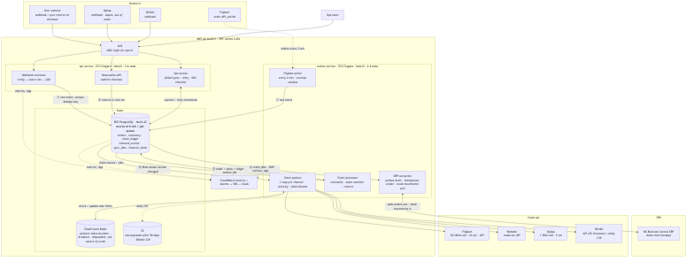
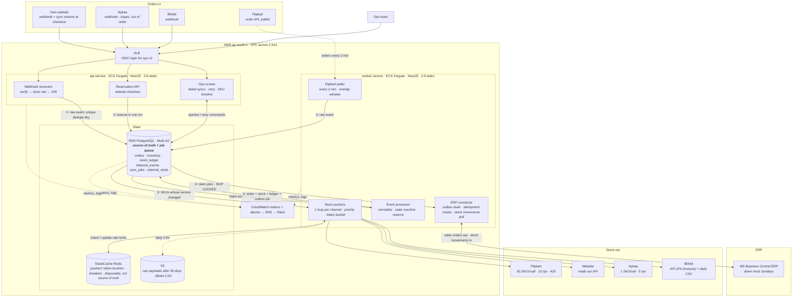

# Order & Inventory Sync Service: Design

*Mars Cosmetics engineering assessment · Ritwik Sharma · October 2026*

## Summary

Peak load is ~300 orders/min (5/s), which is small; the hard parts are correctness and channel limits.

1. **PostgreSQL is the single source of truth** for orders, stock, the audit ledger and the job queue. Each change (order + stock + ledger + outbound job) commits in one transaction; Redis holds only disposable rate-limit state.
2. **A marketplace order is already sold when we hear about it.** So oversells are fought twice: an atomic reservation decides who gets the last unit, and a **publish policy** stops channels that see changes late (Flipkart polls every 2 min) from showing the last units.
3. **Stock pushes are state, not events:** the latest absolute quantity per (channel, SKU), coalesced, low stock first, within each rate limit. Retries are idempotent and work is bounded.
4. **ERP delivery is effectively-once:** outbox + retries + idempotent create keyed on our order id.
5. **One NestJS codebase, two ECS Fargate services**, ≈ ₹36k/month.

## 1. Architecture



<details>
<summary><b>View Mermaid Diagram Source</b></summary>


</details>

*Source: [`architecture.mmd`](architecture.mmd). ① store raw event → ② reserve → ③ push stock → ④ send to ERP.*

| Component | Runs on | Responsibility |
|---|---|---|
| `api` | ECS Fargate (ARM), 2–6 tasks, CPU autoscaling | Webhook receivers, synchronous reservation API for website checkout, ops screen |
| `worker` | ECS Fargate, 2–6 tasks | Event processor, Flipkart poller, a stock pusher per channel, ERP connector, cron jobs. Singletons hold a Postgres advisory lock; the other task is a hot standby |
| PostgreSQL 16 | RDS Multi-AZ, db.t4g.medium, 7-day PITR | All durable state, including the job queue |
| Redis | ElastiCache, one small node | Shared token buckets and breaker state; losing it loses nothing durable |
| Other AWS | S3, Secrets Manager, CloudWatch + SNS, NAT gateway | Payload archive and Blinkit CSVs; credentials; alarms to Slack; fixed egress IP (A2) |

**Cost** (approx. on-demand, ap-south-1): RDS ₹11k, Fargate ₹6k, NAT ₹3.5k, ALB ₹2k, Redis ₹2k, other ₹3k ≈ **₹28k prod** + ₹8k staging = ₹36k of ₹50k.

## 2. Data model

| Table | Key columns | Constraints |
|---|---|---|
| `inbound_events` | channel, dedupe_key, external_order_id, event_type, payload jsonb, status, error | UNIQUE(channel, dedupe_key); replayable raw truth |
| `orders` | id, channel, external_order_id, status, payment_mode, total, pincode, hold_expires_at, erp_doc_no | UNIQUE(channel, external_order_id) |
| `order_items` | order_id, line_no, sku, qty, unit_price, line_status (RESERVED/SHORT/RELEASED/SHIPPED) | PK(order_id, line_no); qty > 0 |
| `inventory` | sku, on_hand, reserved, version | PK(sku); reserved ≥ 0; available = on_hand − reserved |
| `stock_ledger` | sku, Δon_hand, Δreserved, balances after, reason, ref_type, ref_id, channel, actor, at | Append-only; UNIQUE(ref_type, ref_id, sku, reason) |
| `channel_stock` | channel, sku, listing_id, last_pushed_qty, pushed_version, buffer, cap, last_error | PK(channel, sku); also the SKU mapping |
| `channel_push_log` | channel, sku, qty, inventory_version, http_status, latency_ms, at | Monthly partitions, 90 days |
| `sync_jobs` | type, aggregate_key, idempotency_key, payload, status, attempts, next_attempt_at, locked_until | UNIQUE(idempotency_key) |

`dedupe_key` = the channel's event id, else a hash of (order id, event type, channel status, channel updated_at).

**No duplicate orders, at four layers:** raw insert `ON CONFLICT DO NOTHING`; orders upserted on (channel, external_order_id); the ledger's unique key allows one stock effect per order line and reason; the ERP create is idempotent (§6).

**Audit:** `stock_ledger` says why and when each SKU's stock changed (order, cancel, BC receipt or write-off, by entry number), and `channel_push_log` says what each channel was shown and when. There is no `CHECK reserved ≤ on_hand`, because a BC write-off must be accepted even when it causes a shortfall (that alerts and publishes 0). The reservation condition alone stops us reserving past on_hand.

## 3. Order ingestion

- **Webhooks** (website, Nykaa, Blinkit): verify HMAC (A3), insert the raw event, return 200 in ~50 ms. Duplicates hit the unique key and still get 200; a failed insert returns 5xx so the channel retries. With no business logic in the request, slow processing can't cause redelivery storms.
- **Polling** (Flipkart): one poller every 2 min fetches orders updated since `watermark − 10 min`. The overlap catches late writes; the watermark moves only after every page is stored. Uses 2 of the 10 req/s.
- **Processing:** workers claim events with `FOR UPDATE SKIP LOCKED`, a per-channel adapter maps them to the canonical event, and the order state machine applies them; reserved within ~2 s.
- **Out of order:** cross-system timestamps aren't trusted. States only move forward (RECEIVED → HELD → RESERVED → SHIPPED → RETURNED; CANCELLED is terminal). A CANCELLED arriving first creates a tombstone, so the late CREATED is a no-op and reserves nothing.
- **Bad payload / unknown SKU:** event marked FAILED and shown to ops; replayed after the mapping is fixed.
- **Channel down:** channels share only the database, so others carry on. A 15-minute poll of each order-list API (A4) recovers missed webhooks via the same dedupe path; a "minutes since last order" alarm catches silent failures.

## 4. Inventory consistency: the last unit, sold twice in one second

Reservation is one conditional UPDATE per line, inside the order's transaction:

```sql
UPDATE inventory SET reserved = reserved + :qty, version = version + 1
 WHERE sku = :sku AND on_hand - reserved >= :qty
RETURNING on_hand, reserved;
```

Under READ COMMITTED, a second transaction on the same row waits for the row lock, then **re-checks the WHERE clause against the committed row**. With no gap between read and write, one unit can't be handed out twice.

**Case 1: website and Nykaa.** MRS-LIP-104: on_hand 10, reserved 9, available 1; both show 1.

| Time | Website | Nykaa |
|---|---|---|
| .10 s | | Order placed on Nykaa; webhook stored, processor claims it |
| .15 s | Buyer clicks Pay; checkout calls `POST /reservations` | |
| .16 s | T1: 10 − 9 ≥ 1 → reserved = 10, ledger row, commit | T2: same UPDATE, waits for T1's lock |
| .17 s | 200 + 15-min hold; payment proceeds | Re-check 10 − 10 ≥ 1 fails → 0 rows → line SHORT, order BACKORDERED, ops alert, no ERP job |
| < 3 s | Version change wakes all pushers; qty 0 goes out first | |

Whoever reaches the row first wins. If the website loses, checkout gets 409 *before payment*: "sold out", nothing to cancel. **The website can never oversell**; only marketplace orders can be SHORT, and ops fulfil them from an incoming receipt or cancel them (counts toward the 0.5%).

**Case 2: Nykaa and Flipkart.** Both sales are final before we hear of either. Nykaa's webhook wins in seconds; Flipkart's order surfaces at the next poll, up to 2 min later, and is SHORT. No lock can fix a sale we learn about 2 minutes late, so the fix must come earlier: **slow channels must not show the last units.**

**Publish policy.** Each channel has a *blind window* W: time for a sale elsewhere to reach its display, plus time for its own sales to reach us. Start values: website 0 s, Nykaa ~60 s, Blinkit ~90 s, Flipkart ~180 s, tuned from measured push lag.

```
velocity(sku)     = max(units reserved in last 15 min / 15, planned sale velocity)
threshold(c, sku) = max(floor_c, ceil(velocity × W_c × 1.5))
publish(c, sku)   = available ≤ threshold ? 0 : min(available − buffer_c, cap_c)
```

As a SKU runs down, channels drop out slowest first, and the website sells the last units. A hero lipstick selling 30/min leaves Flipkart at ~135 units, Blinkit at ~68, Nykaa at ~45; a slow SKU stays everywhere down to 1–3 units. We trade a few marketplace sales near zero for far fewer cancellations; ops can override per SKU.

**Reservation pseudo-code**

```
reserveOrder(orderId):
  BEGIN
    order = SELECT … FROM orders WHERE id = orderId FOR UPDATE      -- one processor per order
    IF order.status != 'RECEIVED': COMMIT; RETURN order.status       -- replay = no-op
    FOR line IN order.items ORDER BY sku:                            -- fixed lock order: no deadlocks
      row = UPDATE inventory … WHERE sku = line.sku AND on_hand - reserved >= line.qty RETURNING …
      IF row:                       INSERT stock_ledger(+qty, 'RESERVE', ref = line, after = row); line → RESERVED
      ELSE IF channel = 'WEBSITE':  ROLLBACK; RETURN OUT_OF_STOCK    -- all or nothing
      ELSE:                         line → SHORT                     -- already sold on marketplace
    IF any SHORT:              order → BACKORDERED; INSERT ops_exception
    ELSE IF awaiting payment:  order → HELD (expires now() + 15 min)
    ELSE:                      order → RESERVED; INSERT sync_jobs('ERP_CREATE', key = 'erp-create:'||orderId)
  COMMIT                                                             -- version bump wakes pushers
```

Cancellation reverses this for RESERVED lines (ledger CANCEL_RELEASE); unpaid holds expire via a sweeper. Returns go back on sale only when BC books them sellable (A9). Hot SKUs are fine: the lock lasts ~1 ms and even a hero SKU sees < 10 reservations/s.

## 5. Stock push within 60 seconds

One pusher loop per channel runs every 2 s: select SKUs where `inventory.version > pushed_version`; compute `publish()`; skip if unchanged; send zero-stock first, then low-stock, then oldest; on success store the qty and the version *read before the call*, so a change mid-call stays dirty for the next run. A SKU that changed 30 times costs one call, and a retry can only send a newer value.

| Channel | Limit | Push budget | SKUs per 60 s |
|---|---|---|---|
| Website | none | direct (reads our API, A6) | all, instantly |
| Nykaa | 5 req/s, 1 SKU | 4 req/s, 1 spare | ~240 (the bottleneck) |
| Flipkart | 10 req/s, 50 SKUs, 429s | 8 req/s, 2 for polling | whole catalogue in 3 s; 429 → Retry-After, halve rate |
| Blinkit | ~2% timeouts | ~4 req/s (A12) | ~200; daily CSV resets drift |

A normal day is ~10 SKU changes/min, far inside every budget. At sale peak, changed SKUs can exceed Nykaa's ~240/min, but zero- and low-stock updates go first and land in seconds; a SKU with 400 units that's 90 s stale can't oversell.

## 6. Failure handling

All outbound work is a `sync_jobs` row (ERP) or a dirty `channel_stock` row (channels); nothing lives only in memory.

| Failure | Handling |
|---|---|
| Transient (timeout, 5xx) | Backoff with jitter: 10 s, 30 s, 2 m, 10 m, then every 30 m. Jobs claimed with SKIP LOCKED under a 5-min lease; HTTP timeout (30 s) ≪ lease, so no job runs twice concurrently |
| Rate limits (429) | Per-channel token bucket in Redis; honour Retry-After; back off fast, recover slowly |
| Non-retryable (4xx, unmapped SKU) | DEAD at once, shown to ops |
| ERP Sunday downtime | Breaker opens after 5 failures, probes every 2 min; open-circuit failures don't count toward DEAD. Jobs wait in Postgres (~700 in a normal 2 h, ≤ 36k on a sale Sunday) and drain FIFO at ~10/s. Backlog alarm muted in the Sunday window |
| ERP exactly once | Our id goes into BC `externalDocumentNumber`. Before each create (and after any ambiguous failure) the worker looks it up; if found, it stores the doc no and stops. Per-order jobs run in sequence, so a cancel never overtakes its create |
| Blinkit timeouts | 5 s timeout = "unknown", not failed. The row stays dirty; the next run sends the latest absolute qty, safe either way. Three independent timeouts ≈ 1 in 125,000. > 20% timeouts/min → breaker, alert, runbook to pause low-stock SKUs in the portal |
| Repeated failures | DEAD after 24 h of retries. Ops screen lists DEAD jobs and FAILED events with payload and error; Retry, Retry-all, Discard-with-reason, all logged |
| Isolation | Per-channel loop, bucket, breaker and concurrency cap; a dead channel or ERP only grows its own backlog |
| DB failover | Multi-AZ, 1–2 min: webhooks get 5xx and are re-sent, the poll overlap catches up, nothing committed is lost |

## 7. Observability (day one)

| Metric | Alert when |
|---|---|
| Push lag per channel (p95) and age of oldest dirty SKU | p95 > 60 s for 5 min, or a low-stock SKU dirty > 60 s |
| Oversell rate: SHORT ÷ orders per channel, rolling hour | > 0.25% (half the budget); any website SHORT is a bug |
| ERP backlog: confirmed orders without a BC doc no, oldest age | > 15 min outside maintenance, or > 3 h ever |
| DEAD jobs, FAILED events, open breakers | Any new DEAD; breaker open > 10 min |
| Intake freshness per channel; nightly BC stock drift | Flipkart poll > 6 min old; no website/Nykaa order for 30 min in business hours; any drift |

## 8. Scope: out of v1

- **Second warehouse, bundles, price sync, listing management:** not needed for this problem.
- **Auto-cancelling SHORT orders:** ops decide, since many can be filled from incoming stock.
- **Kafka, microservices, Lambda:** unnecessary at 5 orders/s, and too much for 3 devs in 6 weeks.
- **Learned buffers and stock read-back from channels:** v1 uses the formula plus daily CSV and nightly BC reconciliation; tune after the first sale.

**Delivery (3 devs, 6 weeks).** Weeks 1–2: schema, reservation + concurrency tests, state machine, ingestion, infra (CDK), BC client. Weeks 3–4: push engine and policy, channel adapters, ERP outbox, ops screen, alarms. Week 5: load test at 3× peak, failure drills, **shadow mode** (compute, don't push; compare with the spreadsheet). Week 6: cut over one channel at a time, at least a week before the next sale.

## Stretch B: "Why did SKU X oversell yesterday?"

- **Reads:** not the database. A fixed SQL function builds a ≤ 300-row evidence bundle for (SKU, date): ledger rows, SHORT orders, push log per channel, policy settings, breaker events and pre-computed findings ("Flipkart pushes got 429 from 10:58 to 11:03").
- **No inventing:** the model sees only the bundle and must cite row ids; a validator rejects unknown ids or numbers not in the bundle, then falls back to the plain timeline. It must say when evidence explains nothing. Read-only; evidence shown under each answer.
- **Cost:** ~10k input + 0.5k output tokens per question. At an assumed ~$3/M input tokens, ≈ ₹3 per question, ≈ ₹5k/month at 50/day with a daily cap. Runs on Amazon Bedrock, so data stays in our AWS account.

## Trade-offs

| Decision | Chose | Rejected | Why |
|---|---|---|---|
| Stock reservation | Conditional UPDATE in Postgres, same txn as order, ledger, outbox | Redis Lua counters; read-then-write; SERIALIZABLE | Atomic with no read-write gap. Redis would be a second source of truth outside the order's transaction; ~10/s is trivial for Postgres |
| Job queue | `sync_jobs` + SKIP LOCKED | SQS; BullMQ | Commits with the business change (no dual write); the ops screen is a query. SQS still needs an outbox; BullMQ puts durability on Redis. Revisit at ~100 jobs/s |
| Channel updates | Latest absolute qty per (channel, SKU), prioritised | One message per change | Bursts collapse into one call (fits 5 req/s); idempotent retries; bounded backlog |
| Marketplace oversell | Velocity thresholds, slowest channels drop first | Full stock everywhere; fixed split per channel | Full stock everywhere caused the 900 oversells; a fixed split strands stock. Thresholds act only near zero and are tunable |
| ERP exactly once | Outbox + lookup by externalDocumentNumber | Fire-and-forget; distributed txn | Exactly-once over a network is impossible; an idempotent receiver gets close. v2: BC extension with a unique key |
| Deployment | Modular monolith, two Fargate services | Microservices; Lambda | Three devs, six weeks, 5 orders/s; one pipeline, no cold starts or Postgres pool issues |

## Assumptions

- **A1.** BC is the source of truth for physical stock; we read item ledger entries every 5 min and reconcile nightly. Posting a shipment lowers on_hand and reserved together.
- **A2.** Marketplaces may allow-list our IP, hence NAT with an Elastic IP.
- **A3.** Webhooks are HMAC-signed; API credentials live in Secrets Manager.
- **A4.** Each channel has an order-list API for reconciliation; we don't rely on webhook retries.
- **A5.** Rate limits are per seller account, across all endpoints.
- **A6.** Website checkout can call our reservation API before payment and reads availability from us.
- **A7.** Stock APIs take absolute quantities; marketplaces decrement their own display on each sale.
- **A8.** Marketplace orders are final on receipt; we can cancel (including single lines) but not reject.
- **A9.** Pre-dispatch cancels release stock at once; returns/RTO restock only when BC books them sellable.
- **A10.** "Confirmed" = fully reserved and paid (or COD placed); backordered orders reach ERP only after ops resolves them.
- **A11.** No bundles in v1; channel SKU ids map 1:1 to ours, seeded from the current spreadsheet.
- **A12.** Blinkit's API takes routine updates at ~4 req/s; the CSV upload can be automated (else ops upload a generated file).
- **A13.** BC maintenance appears as 5xx/timeouts in a roughly known Sunday window. One region (ap-south-1); UTC stored, IST shown.

## AI usage

Used Claude (Anthropic) and Gemini to analyse the brief, draft and edit this document, generate the Mermaid diagram, pressure-test the concurrency and failure design, and generate and debug the prototype code in src/. I reviewed every section and the code, and can defend each decision.
